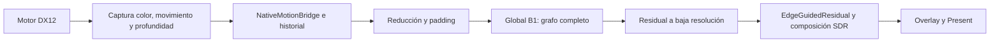

# Arquitectura Windows

## Mapa del código

| Ruta | Responsabilidad |
|---|---|
| `integration/optiscaler/NativeNrBackend.cpp` | API, controlador, preparación, worker, modo y Present |
| `NativeNrRuntime.cpp` | Fábrica privada SDK721, creación/reutilización del dispositivo, SM6.10 |
| `NativeNrHardware.h` | Identificación B580/B570 |
| `NativeNrFfxBridge.h`, `NativeNrFrameInput.h`, `NativeNrFfxState.h` | Metadatos y estados del puente temporal |
| `NativeNrLifecycle.h`, `NativeNrQueueHook.h` | Record/submit/reset/retire y cola |
| `NativeNrModes.h`, `NativeNrControl.h` | Selector y estado del overlay |
| `src/native/nr_session.h` | Sesión residente y política aceptada |
| `src/native/dml_runtime.h` y `dml_graph_pipeline.h` | Tensores, ejecución, presupuesto y grafo híbrido |
| `src/native/nr_linalg_graph.h` | Shaders y consultas de soporte matricial |
| `src/native/native_assets.h` | Manifiesto, formas, archivos y hashes del modelo local |
| `installer/GenericInstaller.cs` | Instalación/restauración transaccional |

## Contrato de dispositivo y recursos

Los recursos del juego y NR deben pertenecer al mismo dispositivo nativo. No mezclar dispositivos de diferentes SDK ni asumir que una interfaz envuelta es la interfaz nativa. La fábrica privada no debe reemplazar indiscriminadamente el SDK global del juego.

La GPU procesa una inferencia por fotograma cuando NR está activo. Se graban/enlazan comandos en cola DIRECT, se preservan estados y se presenta respetando dependencias. La CPU sigue orquestando comandos: «100% GPU» se refiere al flujo de tensores, no a eliminar la CPU del programa.

No escribir descriptores usados por trabajo pendiente. No resetear allocator/lista ni liberar buffers antes del fence correspondiente. Un trabajo grabado pero todavía no enviado también conserva recursos: no equivale a GPU completada. Los callbacks se deben reenviar exactamente una vez incluso si NR falla.

## Modos y memoria

Cada selección lleva una generación. Una preparación obsoleta no puede publicar su sesión después de una selección nueva. Retirar cachés y sesión anterior, resolver trabajo grabado/en vuelo y crear historial limpio. No mantener los cinco grafos completos simultáneamente en VRAM.

La asignación consulta `QueryVideoMemoryInfo` del adaptador real. Capacidad física y presupuesto disponible no son equivalentes: el juego ya ocupa memoria. B570 dispone de menos margen; el soporte experimental no desactiva estas protecciones.

## Temporal

Capturar antes de que el motor recicle los recursos; validar resolución, formato, plano, escala/signo de vectores, jitter y convenciones de profundidad. Asociar entradas al fotograma realmente enviado, no al momento en que se ejecutó un callback de CPU.

Reproyectar historial, tratar disoclusiones y rechazar historia inválida. Reiniciar tras cambio de modo, resize o corte incompatible. Una mezcla temporal que suprime el residual puede reducir el efecto sin resolver la causa del parpadeo. Evaluar también movimiento, apuntado, pelo, rejillas y luces emisivas.

## Resolución, residual y precisión

La resolución de inferencia es distinta de la resolución del backbuffer. El coste de la red depende sobre todo de la primera; reducción, bordes, puente y composición dependen también de la salida. Por ello el coste total no es idéntico en 1080p y 1440p.

El modelo no es una simple sustitución por INT8. La ruta aceptada conserva FP16 matricial y operaciones FP32 donde corresponde. Los ensayos INT8 permanecen separados; no presentar sus ganancias aisladas como aceleración del grafo desplegado.
